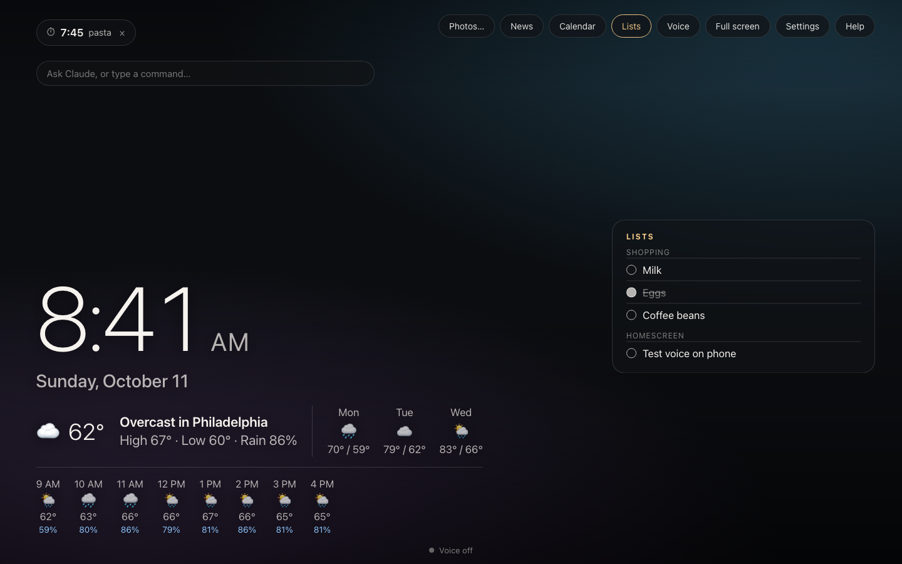
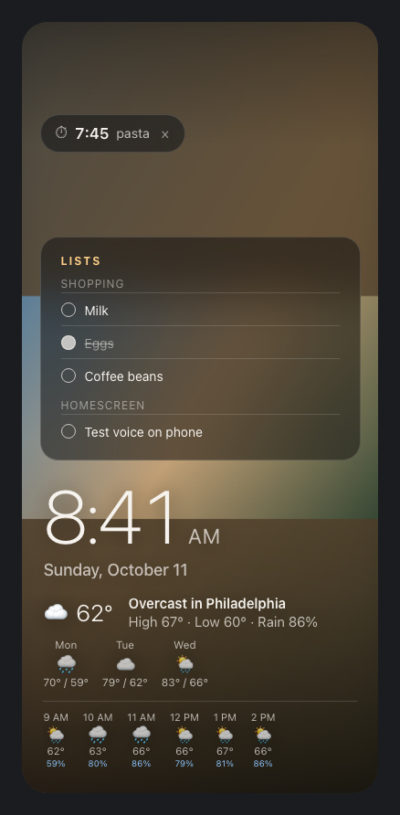
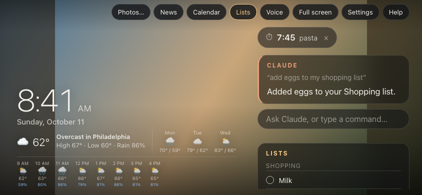

# Hub

An always-on smart display that runs in a browser tab. Put it full screen on a spare Mac, or add it to a docked phone's home screen, and it shows your photos, the time, weather, headlines, your calendar, lists and timers, with a Claude voice assistant on top.

It is one HTML file plus a small PHP helper. There is no build step, framework or account system: each browser keeps its own settings.

Live: [hub.cedarwater.net](https://hub.cedarwater.net) (it opens with a setup guide; everything you enter stays in your browser).



| Phone, upright | Phone, sideways in a dock |
|---|---|
|  |  |

## Features

- **Photos** from a Google Photos shared album (or a folder on the Mac), cross-fading with a slow drift. New photos added to the album appear on their own. Swipe on a phone to change photos.
- **Clock and weather** from Open-Meteo as small cards: today (feels-like, wind, humidity), sunrise and sunset with hours of daylight, the moon drawn at its current phase (calculated on the device), the next 8 hours, and a 16-day forecast. Click a card to hide it (↺ brings them back), or turn all the weather off with the Weather button; on shorter screens the longer forecasts step aside on their own.
- **Calendar** from Google Calendar's secret iCal address, with a Day / Week / Month switch (a month grid with dots on busy days and what's coming up). Recurring events, all-day events and cancelled instances are handled by ical.js.
- **News** from Google News RSS, shown automatically in the morning, with an optional topic.
- **Lists, timers and alarms** handled on the page itself by voice or typing: "add oat milk to my shopping list", "set a pasta timer for 8 minutes", "wake me up at half past 6".
- **Claude assistant** for anything else. It sees what is on the display (weather, calendar, lists, timers, what is shown or hidden, an optional project status file) and can act on it through tools: add to or update lists, set timers and alarms, play and control music, and change the view (weather cards, calendar day/week/month, news, lists, photos). Replies are spoken with the most natural voice installed on the device.
- **Voice** with a wake word ("hey Claude") through Chrome's speech recognition, tolerant of the usual mishearings ("hey cloud", "hey clyde").
- **Music player** on the screen: "play Khruangbin" searches YouTube (Data API, embeddable music only), plays the top result and queues the rest. Pause, next, volume and stop by voice, by button or through Claude; the music ducks while Claude talks or an alarm rings. The player is driven with postMessage, so no YouTube script runs in the page. Without a YouTube key, songs open in a YouTube Music window. "Put on some jams" plays the author's radio (Endless Jam) in the same card, replacing whatever was playing, with the same controls; its track info comes through `fetch.php` because the radio's server only answers its own site.
- **Phone friendly**: upright and sideways layouts, installable to the home screen, keeps the screen awake where the browser allows.

## How it works

```
browser ──► index.html ──────────────► api.anthropic.com      (Claude, with the user's own key)
               │   ├──────────────────► api.open-meteo.com     (weather, city lookup)
               │   ├──────────────────► googleapis.com/youtube  (song search, user's own key)
               │   ├──────────────────► youtube.com/embed       (player iframe, controlled by postMessage)
               │   └──────────────────► cdnjs (ical.js, pinned by SRI hash)
               └─► fetch.php ─────────► photos.google.com, news.google.com, calendar.google.com
```

- **`index.html`** is the whole app: HTML, CSS and one script. Settings, lists and timers live in `localStorage`.
- **`fetch.php`** exists because browsers cannot read Google's album pages, RSS or iCal feeds from another site. It answers only same-origin requests (checked with `Sec-Fetch-Site`, falling back to `Origin`/`Referer`), accepts GET only, fetches only `https` URLs on four Google hosts and the radio's server, follows redirects by hand so every hop is re-checked, caps responses at 12 MB, and stores nothing.
- **Claude** is called straight from the browser with the user's key (`anthropic-dangerous-direct-browser-access`). The page runs a small tool-use loop (up to 5 rounds) with seven tools and a snapshot of the display taken once per question.

## Security and privacy

- **The API key never leaves the browser except to Anthropic.** It is not sent to `fetch.php` or stored on the server. Other visitors start with an empty key field.
- **Own subdomain.** `localStorage` is shared by every page on an origin, so the display runs on its own subdomain where nothing else on the site can read the key. `.htaccess` redirects http and any other hostname there.
- **No unpinned third-party code.** The only external script, ical.js, loads with a sha512 Subresource Integrity hash from cdnjs (falling back to unpkg with the same hash), so a changed copy is refused.
- **The calendar address is a secret.** It is only ever fetched through the site's own helper, never through public relay services.
- **Untrusted text is never parsed as HTML.** Everything rendered from fetched data goes through `textContent`.
- **Pasted keys are cleaned.** Phones can paste invisible characters or turn `-` into a long dash; the page repairs these and explains when a key still isn't valid.

## Limitations

- **Reading a shared Google Photos album is unofficial.** The page pulls `lh3.googleusercontent.com` image addresses out of the album page, so a change at Google can break it. Short `photos.app.goo.gl` links now resolve only with JavaScript, so paste the full `photos.google.com/share/…?key=…` address. Very large albums may show only the photos Google includes in the first page load.
- **Voice recognition sends audio to Google** (it is Chrome's Web Speech API) while Voice is on. It works best in Chrome on a computer or Android; Safari on iPhone stops listening often.
- **A hosted copy routes visitors' album and calendar addresses through that host's `fetch.php`.** It does not log them, but you have to trust the host, so run your own copy for real use.
- **Claude needs your own API key** from the [Claude Console](https://platform.claude.com). Expect roughly half a cent to a cent per question with the default model (`claude-sonnet-5` at low effort).

## Run your own copy

1. Put `index.html`, `fetch.php`, `manifest.webmanifest` and the three icons in a folder on any host with PHP and the curl extension, served over **https** (the microphone requires it). Ideally use a subdomain of its own.
2. Optionally add the rules in `.htaccess`, changing the hostname. On cPanel, add them below cPanel's PHP block rather than replacing the file.
3. Open the page and follow the setup guide. Two settings, the radio page and the project status file, default to this author's site; change or clear them in Settings.

`deploy.sh` is the deploy script used here: it runs the tests, backs up the live page and uploads over SSH. Set `HOST`, `DIR` and `URL` for your server.

## Tests

```
tests/run.sh
```

Runs 100 checks in headless Google Chrome against the real `index.html`: duration and clock-time parsing, local commands, wake-word matching, album and iCal parsing, ringing several timers at once, the Claude tool loop (with the API faked), the photo screen, API-key cleaning, the calendar toggle, the music player, the radio and hiding the Music card. No accounts or keys are needed. The page exposes `window.__hd` (`run`, `heard`, `local`, `parseDuration`, `parseClock`, `extractAlbum`, `eventsFromIcs`, `state`) for driving it without a microphone.

## History

The commit log is the development history. Each version from v5 (the version handed over from an earlier session) to v12 is one commit explaining what changed and why, followed by later fixes. Highlights:

- v6: the default model id did not exist; replies could run out of tokens while thinking; "quarter past 7" set 7:00; the calendar address could fall back to public relays.
- v7: moved to its own subdomain; pinned ical.js by hash; every due timer rings.
- v8: Claude saw its own additions in a refreshed snapshot and reported them as "already on the list"; fixed by snapshotting once per question.
- v10: hourly forecast, phone layouts, home-screen install.
- v11: phone-pasted API keys made `fetch` throw a header encoding error.

Built with [Claude Code](https://claude.com/claude-code).

## License

MIT
